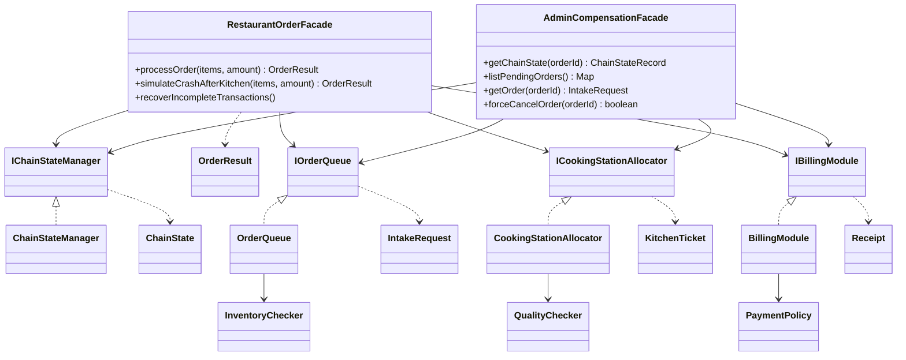

# Assignment 4 — Facade Pattern: Restaurant Order Chain

A small restaurant system split into **three independent subsystems** and hidden behind **two
facades**. Placing a single order drives a multi-step chain across all three subsystems, persists
its progress to disk after every step, and compensates already-committed steps when a later step
fails. On startup the facade inspects the *persisted* state and either finishes or undoes whatever
was interrupted.

The whole point of the design is the **Principle of Least Knowledge**: a client of the primary
facade knows exactly one method, `processOrder`, and nothing about subsystems, databases,
transactions or compensations.

---

## 1. How to run

**Requirements:** JDK **26** (the project targets class-file version 70). If `mvn` picks up an
older JDK it fails with `class file version 70.0`. Point Maven at a JDK 26 if needed:

```bash
# verify
java -version          # must print 26.x

# if your default JVM is older, set JAVA_HOME for the session
export JAVA_HOME=/path/to/jdk-26      # Windows PowerShell: $env:JAVA_HOME='C:\path\to\jdk-26'
```

**Run the interactive demo with a single command:**

```bash
mvn -q compile exec:java
```

**Run the test suite (also produces the coverage report):**

```bash
mvn -q test
# HTML report: target/site/jacoco/index.html
```

**Reset the storage** — all durable state lives in the `./data` folder; delete it to start clean:

```bash
rm -rf data            # Windows PowerShell: Remove-Item -Recurse -Force data
```

---

## 2. Demo

The demo is the *composition root*: the only place that knows all subsystems and their database
files. Everything the user does goes through the two facades.

```
--- RESTAURANT KITCHEN (Facade demo) ---
1. Place an order                        # real input: "Burger 2, Cola 1" + amount
2. Show the persisted state of an order  # inspect all three subsystems + chain state
3. List pending (interrupted) orders     # admin facade: listPendingOrders()
4. Admin: force-cancel an order          # admin facade: state-aware cancel + refund
5. Simulate a crash after the kitchen step  # leaves a PENDING_C chain on disk
0. Exit
```

Typical crash-recovery walkthrough:

1. Option `5` → the process "dies" after the kitchen step; the chain is persisted as `PENDING_C`.
2. Restart the demo (option `0`, run again) → `recoverIncompleteTransactions()` runs first.
3. Option `2` with the printed order id → the order is either resumed to `COMPLETED` (if it had
   been paid) or unwound to `COMPENSATED_AT_C`.

---

## 3. Architecture

Three subsystems, each with its own database, its own persistence gateway and a pure business-rule
class that holds **no state and performs no I/O**:

| Subsystem | Package | Orchestrator | Pure rules (no I/O) | State (JDBC gateway) | Entity + statuses |
|---|---|---|---|---|---|
| A — Acceptance / inventory | `org.aitu.se.acceptance` | `OrderQueue` | `InventoryChecker` | `IntakeRepository`, `InventoryRepository` | `IntakeRequest` (`NEW`, `INVENTORY_RESERVED`, `CANCELLED`) |
| B — Kitchen / backhouse | `org.aitu.se.backhouse` | `CookingStationAllocator` | `QualityChecker` | `KitchenRepository` | `KitchenTicket` (`PENDING_STATION`, `PREPARING`, `QUALITY_PASSED`, `WASTED`) |
| C — Checkout / delivery | `org.aitu.se.checkout` | `BillingModule` | `PaymentPolicy` | `CheckoutRepository` | `Receipt` (`AWAITING_PAYMENT`, `PAID_AND_DISPATCHED`, `CANCELLED`, `REFUNDED`) |

Each subsystem exposes a public interface **owned by the subsystem itself**
(`IOrderQueue`, `ICookingStationAllocator`, `IBillingModule`). The facade depends on these
interfaces, not the other way around, so the dependency graph is acyclic:

```
acceptance ──┐
backhouse ───┼──► facade
checkout ────┘
```

Subsystem A can be compiled, run and tested without the facade and without B or C (see
`SubsystemDirectUseTest`).

Class diagram (Mermaid):



---

## 4. The order chain and its compensations

`RestaurantOrderFacade.processOrder` runs the chain **A → B → C** and persists the progress after
each committed step in the `chain_state` table.

| Step | Subsystem | Commit | Compensation |
|---|---|---|---|
| A | Acceptance | reserve stock (`acceptNewOrder`) | `cancelAndRestock` (return the ingredients) |
| B | Kitchen | cook the meal (`startCooking`) | `compensateTicket` (scrap the ticket → `WASTED`) |
| C | Checkout | charge + dispatch (`processPayment`) | `refund` (receipt → `REFUNDED`) |

Failure handling:

| Failure | What actually committed | Compensation performed by the facade |
|---|---|---|
| **A** (not enough stock) | nothing | none — the order is persisted as `REJECTED`/`CANCELLED` and `OrderRejectedException` is thrown |
| **B** (dish on stop-list, no free station) | A | **undo A** → `cancelAndRestock`, chain → `COMPENSATED_AT_B` |
| **C** (card declined) | A and B | **undo B then A** → scrap the ticket, cancel without restock, chain → `COMPENSATED_AT_C` |

The facade returns an `OrderResult` (order id, ticket id, receipt id, final `ChainState`, failure
reason), so the client can tell success from failure without catching subsystem exceptions.

### Chain states

`STARTED`, `PENDING_B`, `PENDING_C`, `COMPLETED`, `COMPENSATED_AT_A`, `COMPENSATED_AT_B`,
`COMPENSATED_AT_C`, `REJECTED`.

`STARTED` is written **before** step A, so the window between "correlation id created" and "stock
reserved" is never invisible to recovery. The correlation id is generated by the facade, not by a
subsystem.

---

## 5. Crash recovery

`recoverIncompleteTransactions()` runs on startup and consults the **actual persisted state of the
subsystems**, not just the facade's own table:

| Persisted chain state | Recovery checks | Action | Result |
|---|---|---|---|
| `STARTED` | intake order in A | reservation committed → restock | `COMPENSATED_AT_A`; otherwise `REJECTED` |
| `PENDING_B` | kitchen ticket in B | meal already `QUALITY_PASSED` → scrap + write-off; otherwise scrap + restock | `COMPENSATED_AT_B` |
| `PENDING_C` | receipt in C | already paid → **resume** the chain; otherwise scrap the meal and cancel | `COMPLETED` or `COMPENSATED_AT_C` |

Recovery can therefore both **undo** and **continue** a chain, and it distinguishes "the meal was
already cooked" (ingredients are a loss) from "the kitchen never ran" (ingredients are returned).

---

## 6. Principle of Least Knowledge — before / after

**Before (client is coupled to the whole machine).** The client must know every subsystem, its
gateway, the right order of calls, the status enums and even how to undo a partial failure:

```java
InventoryRepository inventory = new InventoryRepository(invUrl);
InventoryChecker checker = new InventoryChecker();
if (available(inventory.snapshot(), items) < required) throw new RuntimeException("no stock");
inventory.decrement(items);

KitchenRepository kitchen = new KitchenRepository(kitchenUrl);
KitchenTicket ticket = new KitchenTicket(UUID.randomUUID().toString(), orderId);
ticket.setStationId(pickFreeStation(kitchen));        // and what if all are busy?
ticket.transitionTo(KitchenStatus.PREPARING);
kitchen.save(ticket);

try {
    receipt = charge(ticketId, amount);               // what if the bank declines?
} catch (PaymentFailedException e) {
    ticket.transitionTo(KitchenStatus.WASTED);          // the client must know the compensation
    kitchen.save(ticket);
    inventory.increment(items);                        // ...and the domain rule behind it
    throw e;
}
```

The client knows four classes, two databases, two status enums, the compensation order and several
edge cases. Any change to a subsystem breaks every client.

**After (client knows one method).**

```java
OrderResult result = facade.processOrder(orderOf("Burger", 2), 2500.0);
```

One call, one result. Everything about subsystems, persistence, ordering, compensation and recovery
lives behind the facade. The client cannot even reach the subsystems' exceptions or databases.

---

## 7. Facade vs. Adapter

This project uses the **Facade** pattern, not Adapter, and the difference is worth stating
explicitly:

| | Facade (this project) | Adapter |
|---|---|---|
| Intent | Simplify a **whole subsystem** behind one convenient interface | Make **one existing interface** usable by a client that expects a different one |
| Scope | Many classes / several subsystems → one entry point (`processOrder`) | Usually one class/interface → another |
| New behaviour | Introduces a **new higher-level operation** (the A→B→C chain with compensations) that no subsystem provides | Provides **no new behaviour** — only translates calls and data shapes |
| Direction | One-way: the facade knows the subsystems; the subsystems do not know the facade | One-way: the adapter wraps the **adaptee** |
| Typical driver | Complexity; hide a cumbersome API | Incompatibility (legacy code, third-party libraries) |

Here, `RestaurantOrderFacade` coordinates **three** subsystems, adds orchestration and durable
recovery, and returns a result type that does not exist in any subsystem — that is squarely a
Facade. A hypothetical `processPaymentAsCharge(...)` wrapper around `IBillingModule` alone, mapping
names and arguments for one client, would be an Adapter.

---

## 8. Realistic failures (no test flags in production code)

The subsystems fail for reasons that are read from their own persisted state; there is no
`forceFail: boolean` parameter anywhere in the public API:

* **A** — the requested quantity exceeds the stock snapshot → `OutOfStockException`.
* **B** — a requested dish is on the kitchen **stop-list** (`KitchenRepository.isOnStopList`) →
  `DishUnavailableException`; or every cooking station is occupied
  (`countByStatus(PREPARING) >= MAX_STATIONS`) → `NoAvailableStationsException`. The stop-list is
  checked **before** any ticket is written, so a rejected order never leaves an orphan ticket.
* **C** — the amount is non-positive or exceeds the card limit (`PaymentPolicy`) →
  `PaymentFailedException`; the declined receipt is persisted as `CANCELLED`.

---

## 9. Tests

50 JUnit 5 tests. The facade tests assert the **persisted end state of all three subsystems**, not
just the returned object, and the recovery tests use a **real reload**:

* `RestaurantOrderFacadeTest` — happy path, each failure path, and recovery after
  `FacadeScenario#reopen()` builds *brand-new* subsystem objects on the *same database file*:
  unpaid `PENDING_C` is unwound, paid `PENDING_C` is resumed to `COMPLETED`, `PENDING_B` is undone
  with/without restock, `STARTED` is resolved with/without a committed reservation, and a repeated
  `STARTED` pass is proven idempotent (no double restock, no state flip).
* `AdminCompensationFacadeTest` — inspection methods and state-aware cancellation with refund,
  including the "meal already cooked" and "already paid" cases.
* `OrderQueueIntegrationTest`, `SubsystemDirectUseTest` — subsystems A/B/C used directly, on their
  own databases, without the facade; the restock compensation is asserted to be idempotent.
* `IntakeEntityTest`, `BackhouseEntityTest`, `CheckoutEntityTest` — entity lifecycles and the pure
  rule classes (`InventoryChecker`, `QualityChecker`, `PaymentPolicy`).

`FacadeScenario` is a small test DSL: `orderOf("Burger", 2)`, `place(...)`,
`assertChainState(orderId, COMPLETED)`, `assertTicketStatus(...)`, `assertStock("Burger", 99)`,
`reopen()`.

Coverage (JaCoCo, `target/site/jacoco/index.html`): ≈**88%** of lines excluding the interactive
`Main`; the remaining gaps are `SQLException` error branches in the JDBC gateways.

---

## 10. Project layout

```
src/main/java/org/aitu/se/
├── Main.java                      # composition root + interactive demo
├── acceptance/                    # subsystem A: intake + inventory
│   ├── IOrderQueue.java           #   public interface (owned by the subsystem)
│   ├── OrderQueue.java            #   orchestrator
│   ├── InventoryChecker.java      #   pure rules (no I/O)
│   ├── IntakeRepository.java      #   JDBC gateway (orders)
│   ├── InventoryRepository.java   #   JDBC gateway (stock)
│   ├── IntakeRequest.java  IntakeStatus.java  OutOfStockException.java
├── backhouse/                     # subsystem B: kitchen
│   ├── ICookingStationAllocator.java  CookingStationAllocator.java
│   ├── QualityChecker.java        #   pure rules
│   ├── KitchenRepository.java     #   JDBC gateway (tickets + stop-list)
│   ├── KitchenTicket.java  KitchenStatus.java
│   └── NoAvailableStationsException.java  DishUnavailableException.java  QualityCheckFailedException.java
├── checkout/                      # subsystem C: payment + delivery
│   ├── IBillingModule.java  BillingModule.java
│   ├── PaymentPolicy.java         #   pure rules
│   ├── CheckoutRepository.java    #   JDBC gateway (receipts)
│   ├── DeliveryDispatcher.java
│   ├── Receipt.java  CheckoutStatus.java  PaymentFailedException.java
└── facade/
    ├── RestaurantOrderFacade.java     # primary facade
    ├── AdminCompensationFacade.java   # secondary (administrative) facade
    ├── IChainStateManager.java  ChainStateManager.java  ChainState.java
    ├── OrderResult.java  OrderRejectedException.java

src/test/java/org/aitu/se/          # 50 tests (see section 9)
```
